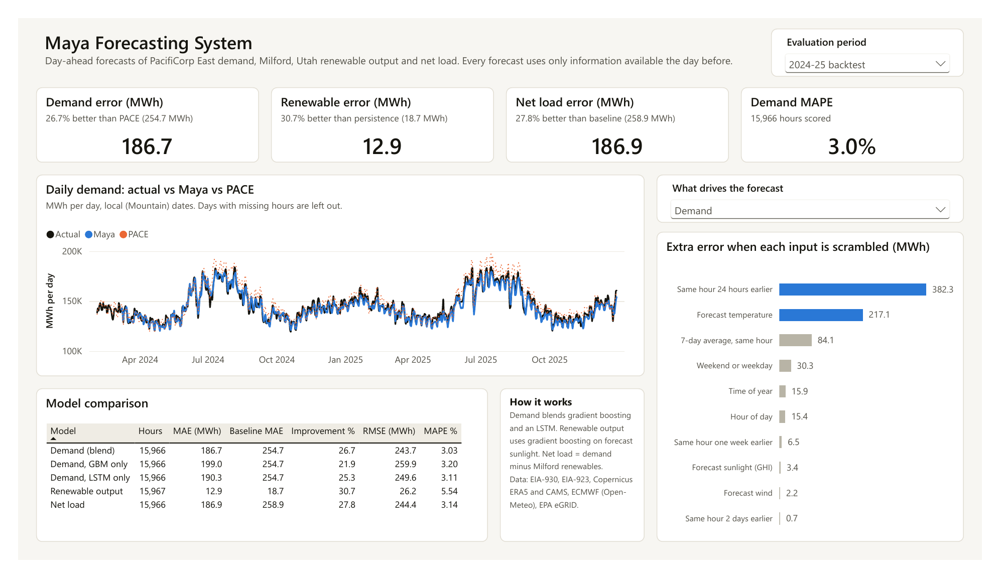

# Maya Forecasting System: Power BI dashboard

Day-ahead forecasts of PacifiCorp East (PACE) electricity demand, Milford, Utah renewable output and net load, rebuilt as a Power BI report.
Purdue University graduate capstone (GRAD 58800/58900, Fall 2026) for Maui Hiva Innovations.

The report replaces the original Streamlit dashboard. It uses the same out-of-sample forecasts, and every headline number matches the original pipeline.

More pages: [Forecast explorer](screenshots/2-forecast-explorer.png), [Where PACE misses](screenshots/3-where-pace-misses.png), [Scenarios](screenshots/4-scenarios.png)

## Headline results

| Test period | Series | Maya error (MAE) | Baseline error | Maya better by |
|---|---|---|---|---|
| Feb 2024 to Dec 2025 | Demand | 186.7 MWh | 254.7 MWh (PACE's own forecast) | 26.7% |
| Feb 2024 to Dec 2025 | Renewable output | 12.9 MWh | 18.7 MWh (same hour yesterday) | 30.7% |
| Feb 2024 to Dec 2025 | Net load | 186.9 MWh | 258.9 MWh | 27.8% |
| Jan to early Sep 2026 | Demand | 211.2 MWh | 347.8 MWh (PACE) | 39.3% |

PACE misses demand by more than 500 MWh in 12.4% of hours; Maya does in 4.4%. 96% of PACE's big misses are over-forecasts, mostly on summer evenings.

## Pages

| Page | What it shows |
|---|---|
| Overview | Accuracy KPIs, daily demand (actual vs Maya vs PACE), model comparison, what drives the forecast |
| Forecast explorer | Any series and date range, drill from days to hours, error for the chosen range |
| Where PACE misses | Error by month, bias by hour of day, month by hour heatmap of PACE's bias |
| Scenarios | Added Milford solar (0 to 3,000 MW) and its effect on net load; a what-if for any 2026 day with changed temperature and sunshine |

A PDF of all four pages is in `Maya Forecasting.pdf`.

## How it is built

- **Format:** Power BI Project (`.pbip`). The report is stored in PBIR (one JSON file per page and visual) and the semantic model in TMDL, so every change is readable in a diff.
- **Model:** a star schema with one hourly fact table (22,584 hours), a marked date table and hour, period and parameter tables. There are 81 DAX measures in a dedicated `_Measures` table, organized by display folder. Local time is Mountain time with daylight saving, converted in Power Query.
- **Scoring:** every error measure uses only hours where the actual, Maya's forecast and the baseline all exist. This matches how the original pipeline scores.
- **What-if:** Power BI can't run the scikit-learn models, so the production models were rerun in Python for every 2026 day across 7 temperature changes and 11 sunshine levels (447,216 rows). The slicers pick from those results.
- **Models:** demand is the average of a gradient boosting model and an LSTM; renewable output is gradient boosting. Both use only information available the day before (ECMWF forecast weather, demand at least 24 hours old).

## Open it

1. Install Power BI Desktop (free).
2. Open `Maya Forecasting.pbip`.
3. The first time, go to **Transform data > Edit parameters** and set **DataFolder** to the full path of this repo's `data` folder (it must end with a backslash). Then select **Refresh**.

## Data sources

EIA-930 (PACE demand and PACE's day-ahead forecast), EIA-923 (monthly plant generation), Copernicus ERA5 and CAMS (weather and clear-sky irradiance), ECMWF day-ahead forecasts via Open-Meteo, EPA eGRID. Milford renewable output is modeled hourly from solar physics and calibrated to EIA-923 monthly totals; it is not metered.

## Files

| Path | What it is |
|---|---|
| `Maya Forecasting.pbip` | Open this in Power BI Desktop |
| `Maya Forecasting.Report/` | Report pages, visuals and the custom theme (PBIR) |
| `Maya Forecasting.SemanticModel/` | Tables, relationships and DAX measures (TMDL) |
| `data/` | The four CSV files the model loads |
| `screenshots/` | One image per page |
| `Maya Forecasting.pdf` | All four pages as a PDF |
